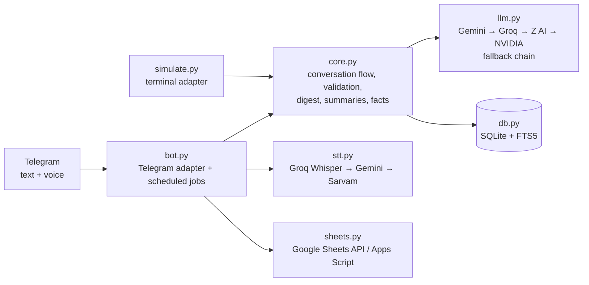

# Heeralal (codename Pluto): a personal AI assistant that remembers

Heeralal is a personal assistant that lives in Telegram. You talk to it the way you'd talk to a
capable human assistant: by text or voice note, in **English, Hindi or Hinglish**. It quietly
remembers what matters, keeps your to-dos and reminders, nudges you until things are done, and
answers questions like *"what's on my plate this week?"* or *"what did we discuss about the
YouTube idea?"* using only what you actually told it.

Code, setup and commands: [`pluto/`](pluto/) · Product rules: [`pluto/CLAUDE.md`](pluto/CLAUDE.md) ·
Research and roadmap: [`pluto/docs/borrow-plan.md`](pluto/docs/borrow-plan.md)

> **Status:** working prototype, used on my own phone. Every feature is covered by automated tests
> (213, using stand-ins for the AI and Telegram) and a terminal simulator with a movable clock.
> The next milestone is a 24/7 deployment.

---

## The problem

Ideas, promises and small tasks get lost between chats, notes apps and calendars. Most to-do
apps need forms and categories, and most chatbots forget everything once the chat scrolls away.
I wanted one place I can just *talk* to, in the language I actually think in (Hinglish), and
that turns what I say into structured, searchable memory and follow-ups. It should stay honest
about what it does and doesn't know.

## What it does today

| Area | Capability |
|---|---|
| **Conversation** | Natural chat in English, Hindi or Hinglish, by text or voice note. Small talk gets a reply and isn't saved. |
| **Memory** | Facts and ideas you share are saved automatically ("Rahul ka birthday 5 March ko hai" → 📝 note). Your original words are stored untouched. |
| **To-dos and reminders** | Created only when you ask ("remind me…", "todo…"). It asks *"Kab yaad dilaun?"* if a reminder has no time, understands "kal shaam", "in 10 minutes" and "2 ghante mein", and offers *"Add it as a to-do?"* when you only mention a task. |
| **Priorities** | Taken from your own words: "urgent", "zaroori", "jaldi" → 🔴 high; "no rush" → low. |
| **Planning questions** | "What's on my plate today / this week / this month / overall?", sorted by urgency. Time buckets are computed in code, not guessed by the model. |
| **Recall** | "What have we discussed about X?" uses full-text search over every saved item and message, plus a rolling summary of older chats. |
| **Long-term profile** | Each night it distils lasting facts about you (people, birthdays, preferences, routines) from recent chats and notes. You can view or delete them. |
| **Proactive** | Reminders arrive at the exact minute you set, follow-up nudges are capped with quiet hours, and a **morning digest** lists what's overdue, what's due today and one old idea, sent only when there's something to say. |
| **Done from chat** | "Rahul ko deck bhej diya" marks the matching item done. |
| **Dashboard** | Optional Google Sheet with Dashboard, To-dos, Done and Notes tabs, kept in sync automatically. |
| **Control and privacy** | `/list`, `/done`, `/snooze`, `/delete` (removes the item and anything derived from it), `/forget`, `/export`, `/facts`, `/summary`, `/model`, `/digest`, `/sheet`. |

## Architecture

- **The model proposes, the code decides.** The LLM returns a reply plus proposed actions as
  JSON. `core.py` checks every action against the database before applying it: it only saves
  what was asked, only marks *your own open* items done, and withholds any reply that cites an
  item id you don't have.
- **Transport-agnostic core.** The same flow runs behind Telegram and a terminal simulator, which
  makes the whole product testable without a network.
- **Layered memory, all in SQLite:** the last 30 messages word for word, a rolling summary of
  older chat, FTS5 full-text search over everything, and a nightly-consolidated profile. No vector
  database and no extra services.
- **Resilient AI:** four providers behind one interface with automatic fallback, a `/model`
  switch, and a fail-safe: if every model is down, the message is still saved as a plain note.

## How it was built: iteratively, in small increments

I ran the project like a one-person agile team. I acted as product owner and developer: I set the
goals and product rules, prioritised the backlog, used the bot myself, and turned what I noticed
into the next increment. I built it with **Claude Code as an AI pair-programmer**. Each increment
came with its own tests and updated docs, and went into `main` through a pull request
(8 merged so far) once the full suite passed.

| # | Increment | Why (trigger) | Result |
|---|---|---|---|
| 0 | **Prototype** | First idea: capture → label → remember → recall → nudge | Telegram bot with SQLite and an LLM labeller |
| 1 | **Harden phase 1** | Needed to trust it before using it daily | Core/adapter split, Gemini, fail-closed access, 58 tests, simulator, written product rules |
| 2 | **Conversational assistant** | My feedback: *"not interactive as a chatbot"* and *"save info, but to-dos only when I ask"* | Chat with proposed actions, auto-saved info, explicit to-dos, priorities, agenda questions |
| 3 | **Resilience** | Rate limits ("make sure it doesn't run out of thinking") | Groq, Z AI and NVIDIA fallback, `/model` picker, `--check` that never prints keys |
| 4 | **Bug fixes from real use** | *"Can't read voice notes"*, *"no reminder notifications"* | Speech-to-text fallback chain; reminders checked every minute and always delivered on time |
| 5 | **Research spike** | Wanted a better design than my own first guess | Studied two open-source agent frameworks (nanobot, MIT; QwenPaw, Apache 2.0) and wrote a borrow plan, including what *not* to build |
| 6 | **Morning digest** | Top item in the borrow plan | One deterministic message a day, skipped when empty, with no LLM cost |
| 7 | **Full-text search** | Recall was limited to the last 300 items and 100 messages | SQLite FTS5 with triggers, Hinglish-aware stop words, a `LIKE` fallback, and bounded prompt size |
| 8 | **Rolling summaries** | Long chats should keep their gist | A summary of chat outside the recent window; fails safe and respects `/forget` and `/delete` |
| 9 | **Google Sheet dashboard** | Wanted a visual tracker | Three ways to connect (Apps Script, service account, via Claude), protected against formula injection |
| 10 | **Nightly profile facts** | Last item in the borrow plan | Automation never edits or deletes a fact; short-term facts expire; the user can view and delete |

Test suite growth across increments: **58 → 99 → 141 → 192 → 213**.

## Skills demonstrated

- **Product thinking:** framing the problem, writing explicit product rules (never overwrite the
  user's words, never invent a memory, ask before outside actions), turning my own feedback into
  backlog items, and cutting scope deliberately.
- **LLM application engineering:**
  - structured JSON outputs validated in code;
  - a guard against made-up citations;
  - prompt design for multilingual (Hinglish) input;
  - prompts that treat user text as data, not instructions;
  - multi-provider fallback;
  - summarisation and memory consolidation pipelines;
  - keeping token use bounded however long the history grows.
- **Backend Python:** async Telegram bot with scheduled jobs, a clean core/adapter
  architecture, SQLite schema design with in-place migrations, and FTS5 indexes kept in sync by
  triggers.
- **Integrations:** Telegram Bot API, Gemini, Groq, Z AI, NVIDIA, Groq Whisper and Sarvam speech
  APIs, the Google Sheets API (service account), and a Google Apps Script web app.
- **Security and privacy by design:**
  - secrets only in `.env` and never logged;
  - a fail-closed user allow-list;
  - formula-injection prevention;
  - `/delete` and `/forget` cascading to search indexes, summaries and facts;
  - full `/export`.
- **Testing and quality:** 213 pytest tests with fakes for the AI, Telegram and Google, so no
  test needs a network or a key. Plus a terminal simulator with time travel for reminders and
  digests.
- **Research and licence awareness:** reading large open-source codebases, extracting the ideas
  worth borrowing, and re-implementing them without copying code.
- **Agile delivery with AI tooling:** small, reviewable pull requests, a test suite run before
  every merge, docs updated with each change, and effective direction of an AI coding assistant.

## Tech stack

Python 3.11+ · python-telegram-bot (with its scheduled-job queue) · SQLite and FTS5 · Google GenAI
SDK · httpx · Groq / Z AI / NVIDIA (OpenAI-compatible APIs) · Groq Whisper / Sarvam speech-to-text
· Google Sheets API and Apps Script · pytest

## What's next

- 24/7 deployment (Railway; a `Procfile` is ready) so reminders arrive while my laptop sleeps.
- Repeating reminders ("every Monday"), and an allow-list so a few friends can use it.
- Two-way sync with the Google Sheet, and meaning-based search if word search isn't enough.
